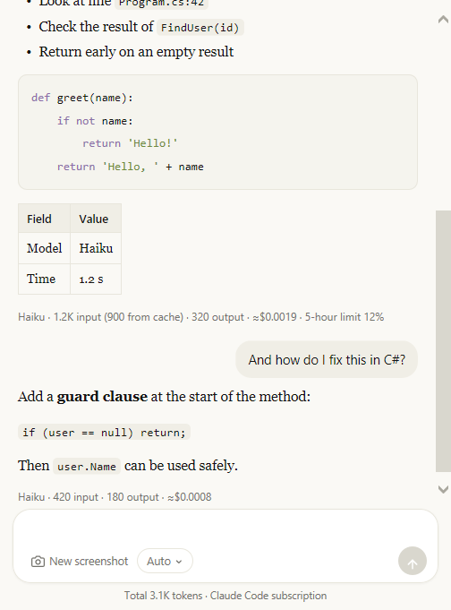
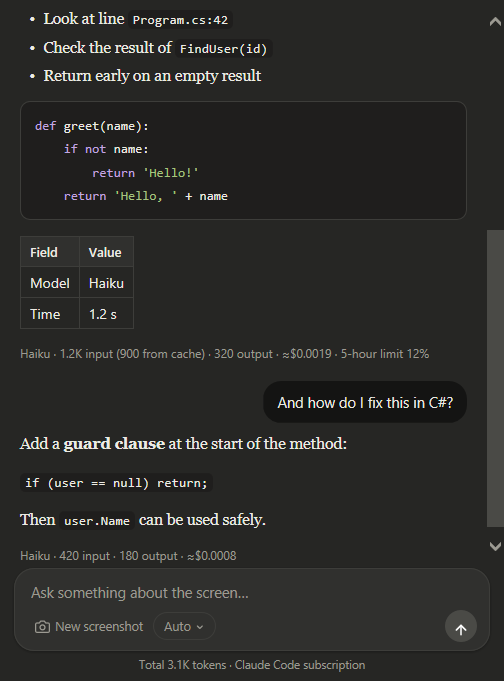

<p align="center"></p>

# Glint

**Ask Claude about whatever is on your screen. Press `Ctrl+Space`, type, done.**

Glint sits in the tray. One hotkey grabs the active window, opens a small chat next to it, and Claude answers. Follow-up questions stay in the same window. The whole app is a ~125 KB `.exe`.

| Light | Dark |
|---|---|
|  |  |

## Features

- **One hotkey**: `Ctrl+Space` captures the active window (or the monitor under the cursor) and opens the chat. Press it again or `Esc` to hide.
- **Cheap by default**: answers come from **Claude Haiku 5.5**. If Haiku decides a question is too hard, it hands it to **Sonnet 5.5**, which can hand it to **Opus 5.5**. You can also pick the model yourself, or start a message with `!` (Sonnet) or `!!` (Opus).
- **Token-aware**: the screenshot is cropped to the active window, downscaled (1280 px long edge, JPEG) and sent only once per capture. A short system prompt, prompt caching, trimmed history and an answer cap keep requests small. Every answer shows its tokens, approximate cost and your 5-hour limit usage.
- **Uses your Claude subscription**: by default Glint talks to the [Claude Code](https://claude.com/claude-code) CLI, so there is no extra bill. An Anthropic API key also works (billed separately by Anthropic).
- **Plays nice with editors**: in VS Code, Visual Studio, JetBrains IDEs, Notepad++ and Sublime, `Ctrl+Space` is passed through for autocomplete; use `Ctrl+Alt+Space` there.
- **Markdown answers** with code highlighting and one-click copy, light and dark theme following Windows, English or Turkish UI following Windows.

## Download

1. Install [Claude Code](https://claude.com/claude-code) and sign in once (`claude` in a terminal). Skip this if you will use an API key.
2. Grab `Glint.exe` from the [latest release](../../releases/latest), put it anywhere and run it. A tray icon appears.
3. Optional: tray icon → *Start with Windows*.

> Windows SmartScreen may warn about an unknown publisher (the exe isn't code-signed). Click *More info → Run anyway*, or build it yourself (below).

## Settings

Tray icon → *Open settings file* (`%APPDATA%\Glint\settings.ini`), then *Reload settings*.

| Key | Default | Meaning |
|---|---|---|
| `hotkey` | `Ctrl+Space` | Main hotkey |
| `hotkey2` | `Ctrl+Alt+Space` | Backup hotkey that works everywhere |
| `passthrough` | editors | Programs where the main hotkey is left to the program |
| `backend` | `cli` | `cli` = Claude Code subscription, `api` = API key |
| `maxEdge` | `1280` | Screenshot long edge in pixels (smaller = fewer tokens) |
| `maxTokens` | `1024` | Answer cap (x4 for Sonnet/Opus) |
| `historyTurns` | `6` | Exchanges kept besides the first one |

The API key is entered from the tray menu and stored encrypted for your Windows user (DPAPI).

## Privacy

Nothing is captured until you press the hotkey. The screenshot and your question go only to Anthropic, through Claude Code or the API. Glint keeps no history on disk (Claude Code keeps its own session files under `%LOCALAPPDATA%\Glint\cli`).

## Build from source

No SDK needed; the C# compiler that ships with Windows is enough:

```powershell
git clone https://github.com/nihat3371/glint
cd glint
.\build.ps1
```

## Family

Small, fast, calm Windows tools: [Mote](https://github.com/nihat3371/mote) (Markdown reader) · Glint.

## License

[MIT](LICENSE)
